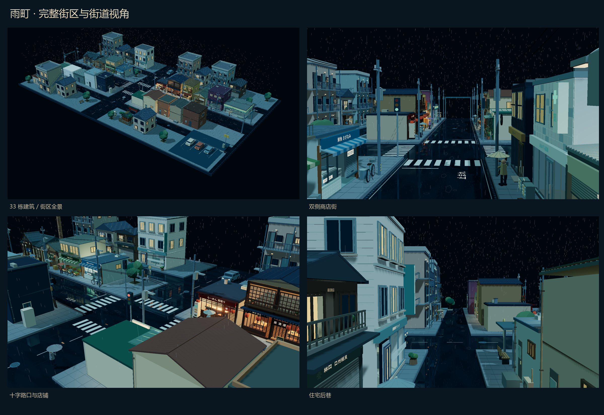

# 雨町 · 完整雨夜街区



下载本仓库 ZIP 并解压后，直接打开 `雨町完整街区.html` 即可离线浏览；完整场景模型为 `雨町完整街区.glb`，26 个独立建筑模型位于 `assets/`。

在原来的 8 种店铺基础上新增 18 种建筑素材，现有 **26 种独立素材、33 栋建筑实例**。数量以 `src/catalog.js` 为准；公寓、住宅和打烊杂货铺在不同街巷复用，其余各出现一次。

场景保留日式微缩 3D、冷色雨夜、暖色窗光和湿润路面，并加入双侧商店街、真实相交的支路、住宅后巷、社区服务、邻近停车区域、鸟居神社和生活道具。建筑层数、门面宽度、退界、屋顶和亮灯状态各有变化。

这是根据实际商店街的业态与街路逻辑设计的虚构街区，**不复刻任何真实地点，也不对应特定动漫作品**。参考依据和设计边界见 [REFERENCES.md](./REFERENCES.md)。

## 查看与操作

构建生成的 `雨町完整街区.html` 是便携入口，包含内联脚本和样式；用支持 WebGL 的现代桌面浏览器打开。也可使用下文的开发服务器。

- 5 个预设视角：街区全景、商店街、十字路口、住宅后巷、另一侧。
- “独立素材”下拉框可单独检查全部 26 种建筑。
- 左键拖动旋转，滚轮缩放，右键拖动平移；双击重新框选当前视图。
- `H` 隐藏/显示界面；`Home` 返回街区全景；“雨”按钮切换降雨。

## 素材与实例

| 分组 | 独立素材 | 街区实例数 |
|---|---|---:|
| 原有 8 种 | 雨宿拉面店、雨音居酒屋、木漏日和菓子店、花与叶花店、月灯旧书店、绿叶理发店、投币洗衣店、钱汤澡堂 | 8 |
| 新增食品与餐饮 8 种 | 雨町面包店、绿叶青果店、涟漪鲜鱼铺、丸福熟食肉铺、雨月寿司店、雨日咖喱食堂、青葉便利店、月舟昭和喫茶 | 8 |
| 新增零售与娱乐 4 种 | 青空药局、港唱片店、山田自行车店、宇宙游戏厅 | 4 |
| 新增居住与社区 6 种 | 雨音公寓 × 4、森田家 × 4、雨町牙科 × 1、雨町邮局 × 1、森田杂货铺 × 2、雨守神社 × 1 | 13 |
| 合计 | 26 种独立素材 | 33 |

“33 栋”指场景中的摆放实例，不能当作 33 种互不相同的模型。公共道路、电线杆、雨棚、车辆、行人、自动售货机和其他街道陈设不计入上述建筑素材数。

## 文件用途

本次已生成以下文件；`previews/街区场景总览.png` 汇总街区与近景，`previews/26种建筑素材总览.png` 展示全部建筑。

| 路径 | 用途 |
|---|---|
| `雨町完整街区.html` | 便携交互预览 |
| `雨町完整街区.glb` | 组合街区，包括建筑和公共街道几何 |
| `assets/*.glb` | 26 种独立建筑，可在 Blender 等支持 glTF 的软件中导入 |
| `asset-manifest.json` | 独立模型、尺寸、预览路径和街区实例变换清单 |
| `previews/` | 5 个街区视角及各独立素材的截图 |
| `src/catalog.js` | 素材目录、建筑实例分布和街区尺寸 |
| `src/shops/` | 20 种店铺的建模源码 |
| `src/urban/buildings.js` | 6 种居住与社区建筑的建模源码 |
| `src/urban/street.js` | 公共道路、设施与天气 |
| `src/main.js` | 相机、界面、材质转换与 GLB 导出 |
| `qa/` | 检查脚本及运行后生成的报告 |

独立 GLB 保留独立网格与材质，适合修改单店并重新组合；源码还可直接调整建筑尺寸、立面、颜色、招牌和摆放逻辑。组合街区为实时显示做了材质合批，因此部分建筑部件已按材质合并；若需要细粒度修改，优先从独立 GLB 或建模源码开始。

## 坐标与拼接

- 单位为米，`+Y` 向上，店面朝 `+Z`。
- 独立素材的原点是门面中心的地面位置 `(0, 0, 0)`；建筑主体向 `-Z` 延伸。
- 宽度、进深和高度为目录中的名义尺寸。屋檐、阳台、空调和门前道具可能超出主体；拼接时应按实际包围盒留间距。
- 独立素材不包含公共道路。街区道路由 `street.js` 统一生成，场景的建筑摆放高度为 `district.ground = 0.27`。
- `asset-manifest.json` 的 `lots` 保存每栋建筑的平面位置、朝向与分区；直接导入完整街区 GLB 可保留组合布局。

本街区约 89 m × 52 m 的边界、路宽、地块间距、层高及建筑细节均为项目设计值，不是对参考街区的精确测绘。

## 开发、构建与导出

在项目目录中运行。首次使用先安装依赖：

```powershell
npm install
npm run dev
```

开发入口为 [http://127.0.0.1:4196/](http://127.0.0.1:4196/)。端口固定为 4196，端口被占用时开发服务器会报错；应先停止占用该端口的旧服务。

保持开发服务器运行，在另一个终端按需执行：

```powershell
npm run check
npm run export
npm run build
```

- `check` 启动本机 Chrome/Edge，读取场景并生成检查报告。使用其他浏览器路径时按检查脚本设置 `BROWSER_PATH`。
- `export` 连接 4196 端口，输出 26 份独立 GLB、组合街区 GLB、预览图片和素材清单；需要本机 Chrome 或 Edge。
- `build` 生成 `dist/` 和内联资源的 `雨町完整街区.html`。

脚本默认连接 `http://127.0.0.1:4196/`，需要检查其他地址时可设置 `SCENE_URL`。

## 本次交付验证

最终离线 HTML 已通过 47 项浏览器检查，包括 33 栋主体不相交、主街与十字支路无建筑侵入、5 个预设视角、26 个独立素材切换、雨效、旋转缩放、横竖屏实际几何边界及无远程资源请求。见 `qa/offline-report.json`。

独立 GLTFLoader 已重新载入 26 个单体和 1 个组合街区，核验内嵌纹理、米制坐标、真实几何和渲染。组合文件的 33 个实例元数据及实际空间变换均与清单一致，地面范围 89 × 52 m。见 `qa/glb-report.json` 及读回截图。

## 导入其他软件时

GLB 提供几何、纹理及可转换的表面材质。浏览器里的实时降雨、雨滴涟漪、镜面反射 shader、色调映射和辉光属于运行时效果，不包含在静态 GLB 中。导入 Blender、游戏引擎或其他软件后，需要按目标软件重新设置灯光、阴影、材质和天气，画面不会自动与浏览器完全一致。

Three.js 的许可文本见构建产物 `THIRD_PARTY_LICENSES.txt`。
